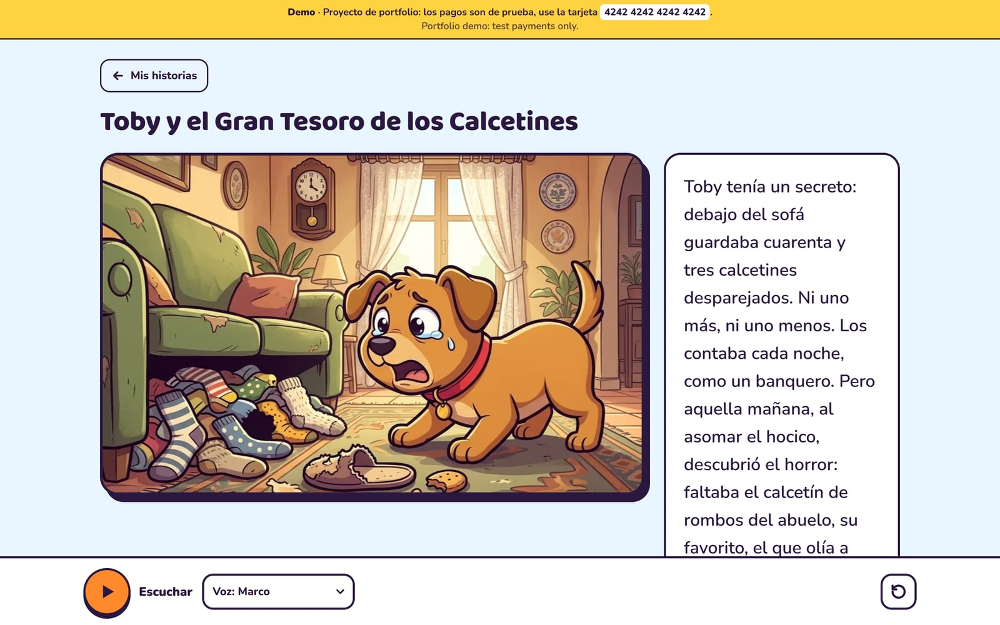
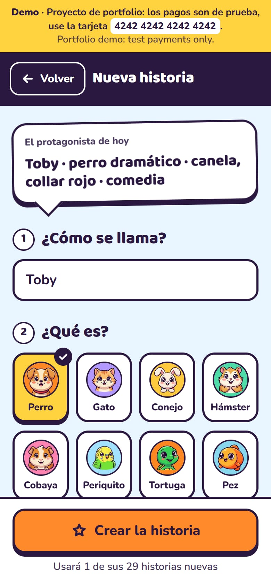
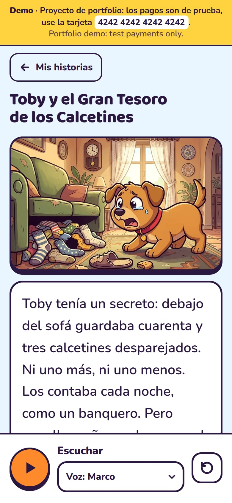
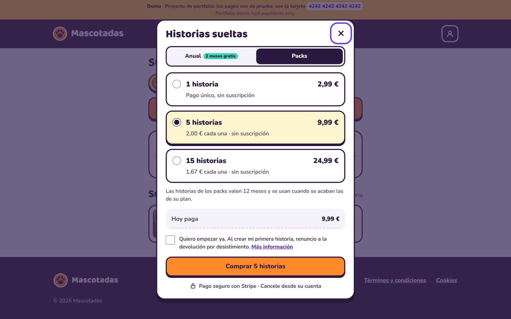
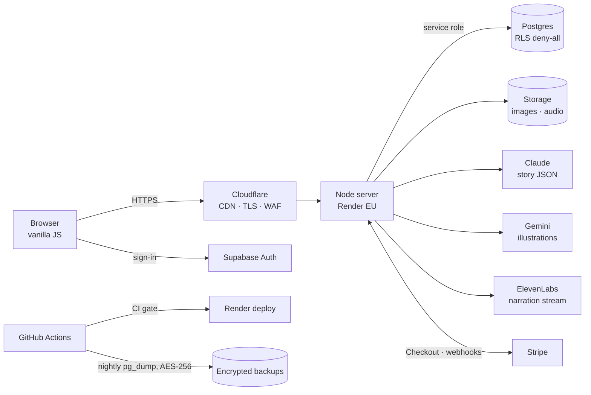

# Mascotadas

**AI-generated, illustrated and narrated comedy stories starring your pet.**
A full-stack SaaS built end to end: product, payments, infrastructure, security and performance.

**Live demo:** [mascotadas.com](https://mascotadas.com) · payments run in Stripe test mode, use card `4242 4242 4242 4242`.
To keep the public demo free to run, it has no AI keys: every pet gets the same pre-generated sample story (text, 6 illustrations and 4 narrations, in `cuento/`), served through exactly the same flow. With API keys set, the real pipeline runs.
The UI is in Spanish (the target market); code comments are in Spanish too.



| Create a story | Read and listen | Choose a plan |
|---|---|---|
|  |  |  |

## What it does

1. The user describes their pet: name, species (16), personality, a quirk, colours, collar and tone.
2. **Claude** writes a 6-page story as structured JSON (text, scene description, setting).
3. **Gemini** paints a character sheet of the pet once, then every page *using that sheet as a reference*, so the pet looks the same across the whole story.
4. **ElevenLabs** narrates each page in one of 4 voices (Spain / Latin America, male / female), streamed while it is generated and cached forever after.
5. The story can be shared through a public read-only link, or as a 1080×1920 image ready for Instagram Stories.

While the illustrations are painted in the background, the reader plays a pet-trivia quiz (with a streak record saved to the account). The story opens as soon as the first pages are ready.

## Tech stack

| Layer | Choice | Why |
|---|---|---|
| Server | **Node.js 24**, plain `node:http`, ES modules | ~550 lines; no framework needed, full control over headers, caching and streaming |
| Front end | **Vanilla JS + CSS**, no build step | Fast first load (Lighthouse 99), nothing to compile |
| Auth | **Supabase Auth**: email one-time code + Google sign-in (GIS with nonce → `signInWithIdToken`) | No passwords; no third-party domain on the Google consent screen |
| Database / files | **Supabase Postgres + Storage** | RLS enabled with no policies: only the server (service role) can read or write |
| AI | **Claude** (text), **Gemini** (images), **ElevenLabs** (voice) | Best fit for each modality |
| Payments | **Stripe** Checkout, Billing, Customer Portal, Tax | Subscriptions, trials, one-off packs, upgrades with proration |
| Email | **Resend** (SMTP for Supabase Auth), Cloudflare Email Routing | Branded sign-in code emails from the own domain |
| Hosting | **Render** (Frankfurt, free tier) behind **Cloudflare** (DNS, CDN, TLS, bot protection, cookieless analytics) | Free to run as a portfolio demo; previously Railway |
| CI / ops | **GitHub Actions** (syntax, tests, `npm audit`), nightly encrypted DB backups, UptimeRobot | The host only deploys when CI is green |

## Architecture



## Engineering highlights

### Payments and pricing logic
- **Two subscription tiers** (monthly or yearly), each with a **monthly and a daily cap**, a **3-day free trial** for both, and **one-off story packs** valid for 12 months that are spent after the plan's allowance.
- Yearly plans grant stories **month by month**, counted from the billing anniversary (handles month-end edge cases like 31 January → 28 February; covered by tests).
- **Unit economics are never negative:** every limit was sized so a customer who uses everything still leaves a margin after VAT, Stripe fees and AI costs.
- **Webhooks are idempotent and order-safe:** the server re-fetches the subscription from Stripe instead of trusting the event payload, ignores stale events for older subscriptions, and records each pack purchase once (the Checkout session id is the primary key).
- **Credits are spent atomically** in Postgres (`SECURITY DEFINER` functions with `EXECUTE` revoked from public roles), so two parallel requests can never spend the same story; a credit is refunded if generation fails.
- **"Start my plan now"** ends a trial early with `payment_behavior: error_if_incomplete`: if the card is declined, the trial stays exactly as it was.
- Only upgrades are allowed in-app (tier up, or monthly → yearly), enforced on both client and server.

### Security
- Strict **Content-Security-Policy**, `Permissions-Policy`, `Cross-Origin-Opener-Policy`, HSTS, `X-Frame-Options`, `no-store` on every API response.
- **Per-IP rate limiting** (general and stricter for expensive endpoints), request/header timeouts against slow-loris.
- Input validation on every route (UUIDs, page ranges, allow-listed voices and products, prototype-pollution-safe lookups).
- Path-traversal protection on static files, covered by integration tests.
- Audio is streamed through short-lived **one-time passes**, so the media element never needs the session token.
- Database is unreachable from the browser: RLS on, no policies, and the anon key cannot call the credit functions (verified).
- Dependency audit in CI; secrets only in environment variables, never in the repo.

### Performance (Lighthouse mobile 90 → 99)
| Metric | Before | After |
|---|---|---|
| Lighthouse performance | 90 | **99** |
| First Contentful Paint | 2.1 s | **1.4 s** |
| Largest Contentful Paint | 3.4 s | **2.0 s** |
| Story illustration size | ~740 KB (JPEG) | **~123 KB (WebP)** |

- AI images are converted to WebP with `sharp` on save; older JPEGs are migrated lazily on first read. Link previews still get JPEG for compatibility.
- **Content-versioned asset URLs** (`/v/<commit>/app.js`) served with `immutable` caching, plus ETag/304 and Brotli for everything else.
- Variable fonts (6 files → 2), `fetchpriority` on the LCP image, code-splitting of the quiz module.
- Moving the origin from US West to EU West cut server response time by ~2.5×.

### Reliability
- **Graceful shutdown:** on `SIGTERM` the server stops accepting connections, finishes in-flight requests and running illustration jobs, then exits; health checks before switching traffic give zero-downtime releases.
- AI calls have timeouts and exponential back-off; failed illustrations are retried in the background and repainted on demand while the reader waits.
- Nightly `pg_dump` of the database, compressed and AES-256-encrypted, kept for 30 days.
- Uptime monitoring on the home page and the health endpoint.

## Run it locally

Everything degrades gracefully, so it runs **without any API key**: without Supabase it keeps data in memory, without AI keys it serves the pre-generated sample story, and without Stripe it simulates payments.

```bash
npm install
npm start          # http://localhost:4173
npm test           # unit + integration tests (node:test)
```

To use the real services, copy `.env.example` to `.env.local`, fill in the keys, and run `schema.sql` and `packs.sql` in the Supabase SQL editor.

## Project map

| File | Purpose |
|---|---|
| `servidor.mjs` | HTTP server: routes, auth check, security headers, rate limiting, caching, graceful shutdown |
| `historias.mjs` | Story writing with Claude (structured JSON output) |
| `fondos.mjs` | Character sheet and scene illustrations with Gemini, retries and time-outs |
| `voz.mjs` | Narration with ElevenLabs: streaming and caching by content hash |
| `cuento.mjs`, `cuento/` | Pre-generated sample story used by the free public demo |
| `pagos.mjs` | Stripe: checkout, packs, upgrades, trial end, webhooks |
| `planes.mjs` | Plan limits and billing-period maths (pure functions, unit-tested) |
| `datos.mjs` | Supabase data access, with an in-memory fallback for local development |
| `public/` | Front end: `app.js` (app), `ilustracion.js` (SVG scenes), `quiz.js`, `publica.js` (public reader) |
| `*.test.mjs` | Unit tests and integration tests that boot the real server |
| `schema.sql`, `packs.sql` | Database schema, RLS and atomic credit functions |
| `.github/workflows/` | CI and nightly encrypted backups |

## Author

Built by **Heri Amezcua**, from idea to production.
